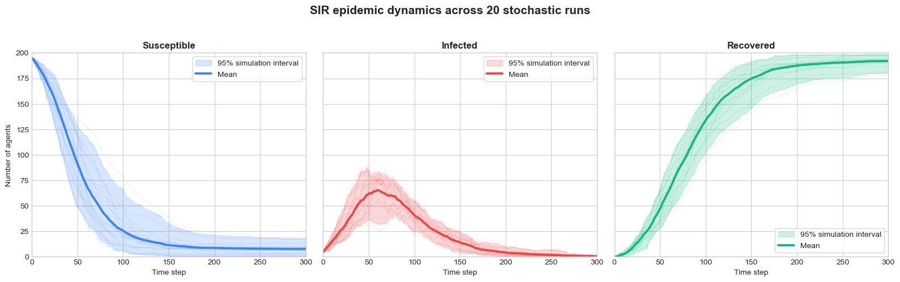
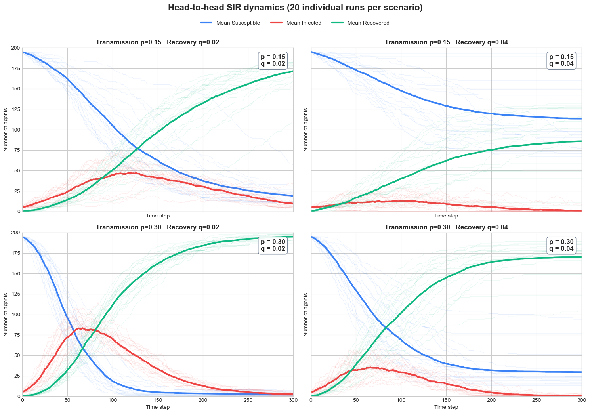
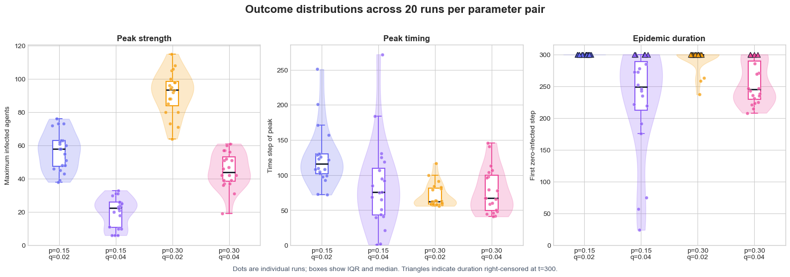
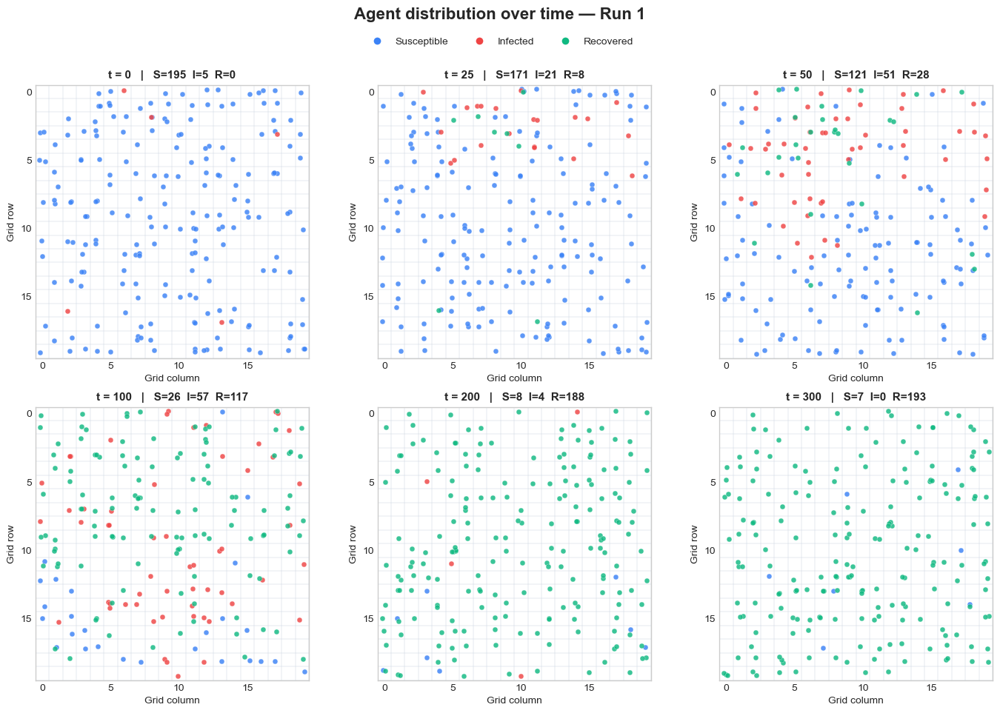
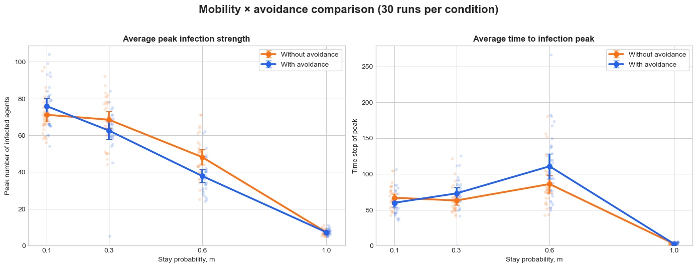
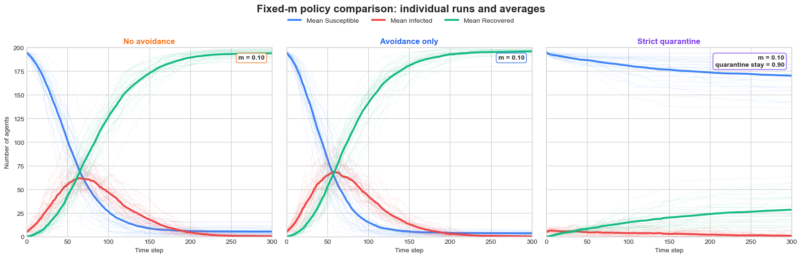
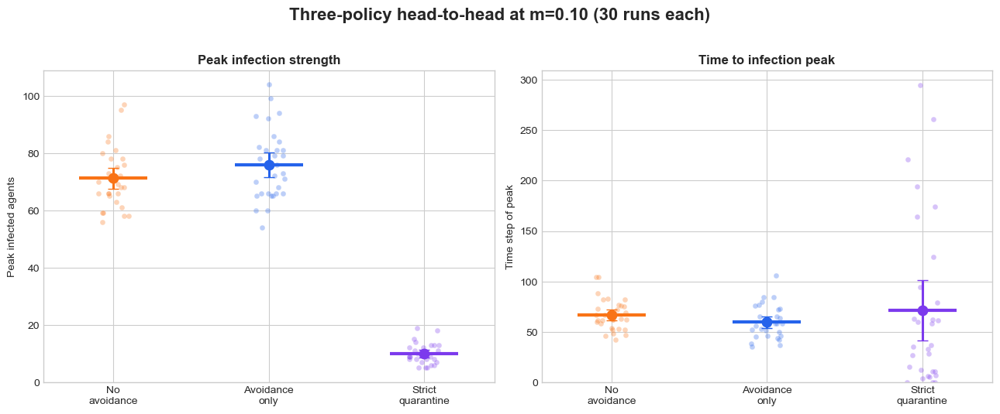
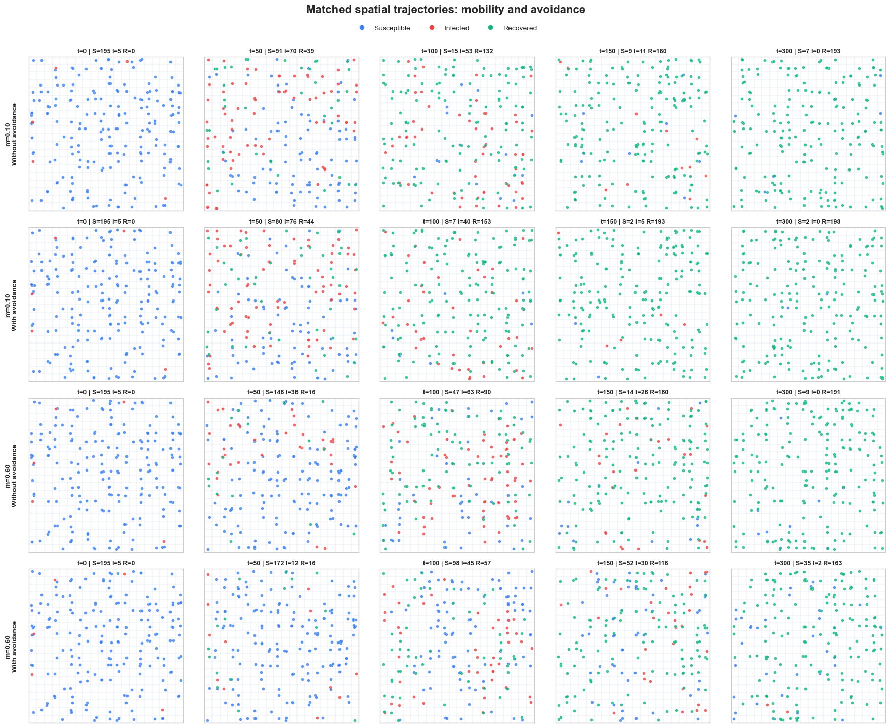
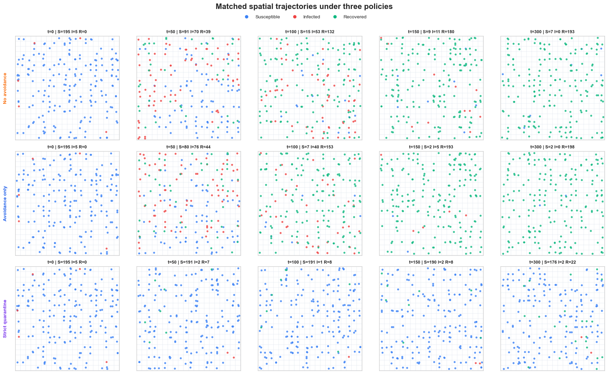

# HW2: Agent-Based Modeling of Pandemic Spread

<div style="text-align: center;">
    Shenghan Wen

swen30@emory.edu
</div>

Statement: Codex (GPT-5.6 Sol) was used to complete this homework. The full chat available at: https://chatgpt.com/s/cx_6ad05c604ff881919d20a37208afd61d.

This project explores stochastic SIR infection dynamics in a population of mobile agents on a bounded two-dimensional grid. It contains two executable Jupyter notebooks:

- [Part A: Base infection model](partA_infection_dynamics.ipynb) — transmission, recovery, epidemic trajectories, and a factorial comparison of `p` and `q`.
- [Part B: Mobility and distancing](partB_mobility_avoidance.ipynb) — stay probability, destination avoidance, and strict quarantine.

The default population contains 200 agents on a 20 × 20 grid: 195 susceptible, 5 infected, and 0 recovered. Each experiment runs for 300 time steps and uses reproducible independent random streams.

## Model overview

At every time step:

1. Agents make a bounded random-walk movement decision.
2. A susceptible agent sharing a cell with one or more infected agents becomes infected with probability `p`.
3. An infected agent recovers with probability `q` and becomes immune.

Movement, transmission, and recovery updates are synchronous within their respective phases. Newly infected agents first become eligible for recovery on the following time step.

## Part A — Transmission and recovery

Part A first demonstrates the base model using `p = 0.35`, `q = 0.03`, and a movement-attempt probability of `0.80`. Twenty runs show the individual stochastic trajectories, ensemble means, 95% simulation intervals, and representative spatial distributions.



### Head-to-head parameter experiment

All four combinations of `p ∈ {0.15, 0.30}` and `q ∈ {0.02, 0.04}` were evaluated using 20 runs per condition.



| `p` | `q` | Peak infected, mean ± SD | Mean peak time | Mean duration | Active at step 300 |
|---:|---:|---:|---:|---:|---:|
| 0.15 | 0.02 | 56.6 ± 11.6 | 125.5 | 300.0 | 20/20 |
| 0.15 | 0.04 | 20.1 ± 8.9 | 84.8 | 227.3 | 5/20 |
| 0.30 | 0.02 | 91.5 ± 13.1 | 70.8 | 292.9 | 17/20 |
| 0.30 | 0.04 | 45.1 ± 10.8 | 77.7 | 254.8 | 5/20 |

Main observations:

- Raising `p` produced stronger peaks. At `q = 0.02`, increasing `p` from 0.15 to 0.30 raised the mean peak from 56.6 to 91.5 infected agents and moved it earlier from step 125.5 to 70.8.
- Raising `q` substantially reduced peak prevalence. The mean peak fell from 56.6 to 20.1 at `p = 0.15`, and from 91.5 to 45.1 at `p = 0.30`.
- Individual runs are largely centered around the average. Only in `p = 0.15` `q = 0.04` simulation 2 runs die out within 10 steps.
- Faster recovery generally shortened outbreaks and reduced the number still active at step 300.
- Duration values at 300 are right-censored: they mean the outbreak remained active when observation ended, not that extinction occurred at step 300.



<details>
<summary>Show a representative Part A spatial trajectory</summary>



</details>

## Part B — Mobility, avoidance, and quarantine

Part B defines `m` as the probability of staying still and compares `m ∈ {0.10, 0.30, 0.60, 1.00}`. Thirty runs are used for each condition.

The basic avoidance rule rejects an intended move if the destination cell contained an infected agent immediately before movement. Avoidance applies to every agent in the current implementation.



| Stay probability `m` | Peak without avoidance | Peak with avoidance | Peak time without avoidance | Peak time with avoidance |
|---:|---:|---:|---:|---:|
| 0.10 | 71.17 | 75.87 | 66.73 | 59.67 |
| 0.30 | 68.50 | 62.60 | 62.87 | 72.77 |
| 0.60 | 48.17 | 37.87 | 85.83 | 110.60 |
| 1.00 | 7.23 | 7.23 | 2.50 | 2.50 |

Main observations:

- Increasing `m` reduces population mixing and sharply lowers peak infection prevalence.
- At `m = 0.60`, avoidance lowered the mean peak by 10.3 agents and delayed the peak by 24.8 steps.
- Simple destination avoidance was not uniformly protective. At `m = 0.10`, it increased the mean peak by 4.7 agents in these runs. This indicates that avoidance of susceptible agents may ot be very effective since that did not the movements of the infected and those who were in close contacts with the infected.
- At `m = 1.00`, no agent proposes a move, so avoidance and no avoidance are identical. Residual transmission can occur only among agents initially sharing cells.

### Strict quarantine at `m = 0.10`

The final comparison adds strict quarantine to avoidance. Every infected agent and every susceptible agent currently sharing a cell with infection receives a 0.90 probability of staying still; other agents retain the baseline `m = 0.10`.



| Policy | Mean peak ± SD | Median peak | Mean peak time | Median peak time |
|---|---:|---:|---:|---:|
| No avoidance | 71.17 ± 10.41 | 69.5 | 66.73 | 62.5 |
| Avoidance only | 75.87 ± 12.30 | 74.5 | 59.67 | 58.0 |
| Strict quarantine | 10.00 ± 3.56 | 9.5 | 71.37 | 36.0 |

Strict quarantine reduced the mean peak by approximately 86% relative to no avoidance. Peak timing under quarantine was highly variable because many runs stayed near their small initial infection level, making the first maximum sensitive to stochastic local transmission.



<details>
<summary>Show matched Part B spatial comparisons</summary>

#### Mobility and avoidance



#### Strict quarantine



</details>

## Hypothesis Revisited

i. Based on the simulation, outbreak peaks are generally smoothed with slower and lower peak infection, confirming the hypothesis.
ii. As projected, there are several runs have behavior largely different from the average (e.g. Part A`p = 0.15` `q = 0.04`, 2 runs die out within 2 steps); most runs follow the general patterns as the average, though.
iii. Indeed all outbreaks simulated are monopeaked.

## Running the notebooks

Python 3.10 or newer is recommended.

```bash
python3 -m venv .venv
source .venv/bin/activate
python -m pip install --upgrade pip
python -m pip install -r requirements.txt
jupyter lab
```

Open either notebook and select **Kernel → Restart Kernel and Run All Cells**. The notebooks contain their current outputs, but rerunning them verifies the results in your environment.

They can also be executed from the command line:

```bash
jupyter nbconvert --to notebook --execute partA_infection_dynamics.ipynb \
  --inplace --ExecutePreprocessor.kernel_name=python3 \
  --ExecutePreprocessor.timeout=180

jupyter nbconvert --to notebook --execute partB_mobility_avoidance.ipynb \
  --inplace --ExecutePreprocessor.kernel_name=python3 \
  --ExecutePreprocessor.timeout=180
```

## Reproducing or extending the experiments

Both notebooks begin with a single configuration object. Edit it to change the grid, population, initial health states, probabilities, number of steps, number of runs, random seed, or snapshot times.

- Part A: edit `ModelConfig` and the `parameter_pairs` list.
- Part B: edit `ExperimentConfig`, `FIXED_M`, and `QUARANTINE_STAY_PROBABILITY`.

The numerical results above are generated from the seeds currently stored in the notebooks. Changing parameters or seeds will change the tables and figures.

## Repository contents

```text
.
├── README.md
├── requirements.txt
├── hypothesis.pdf
├── partA_infection_dynamics.ipynb
├── partB_mobility_avoidance.ipynb
└── figures/
    └── exported notebook figures
```

